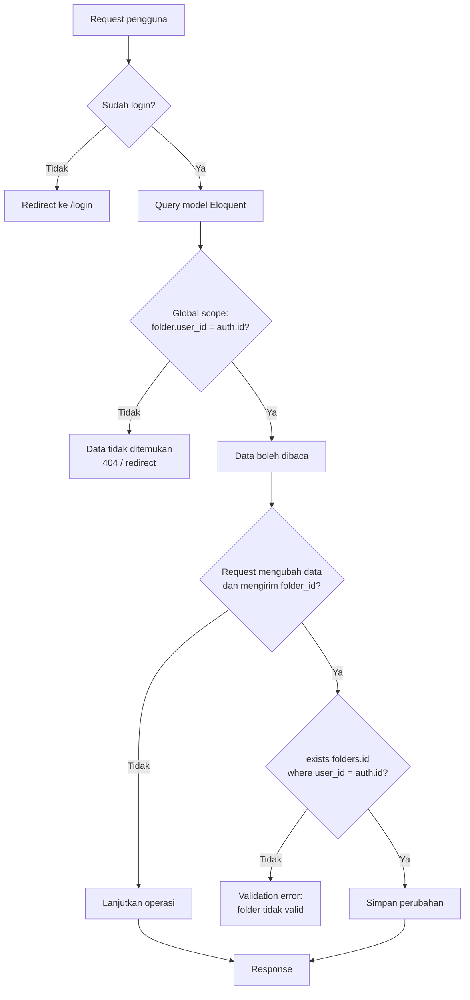
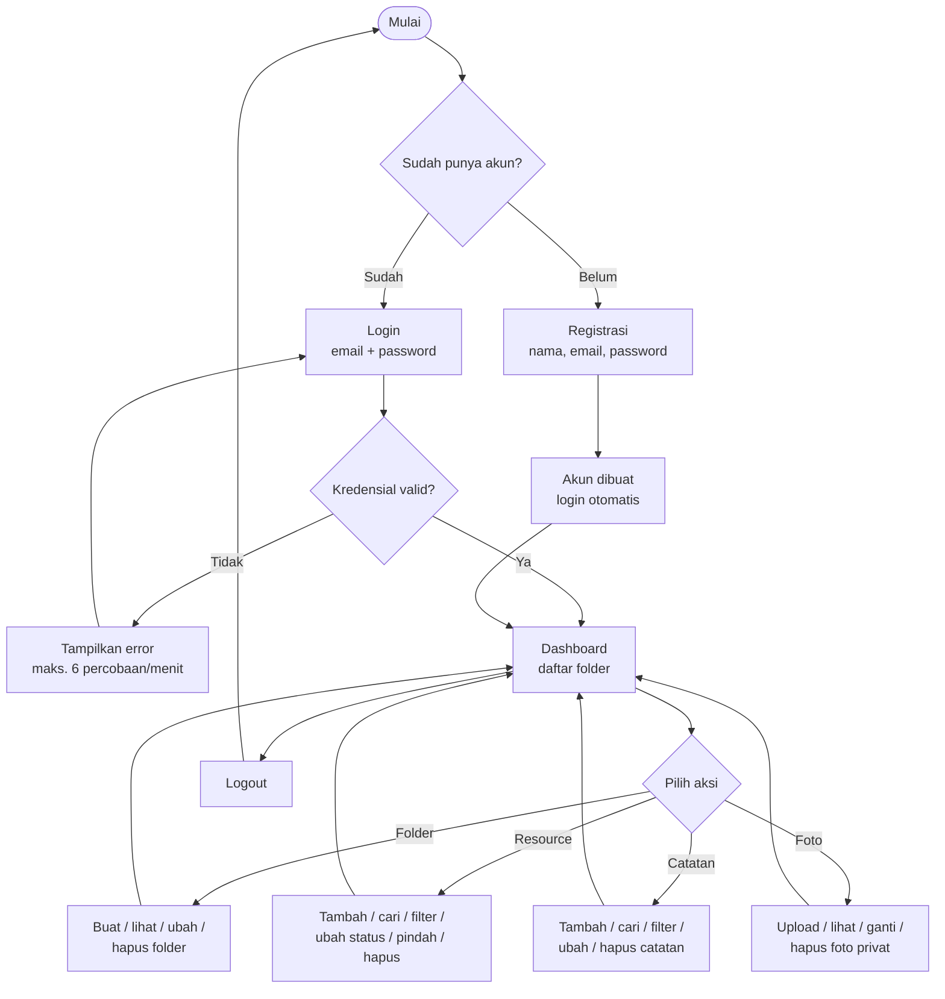
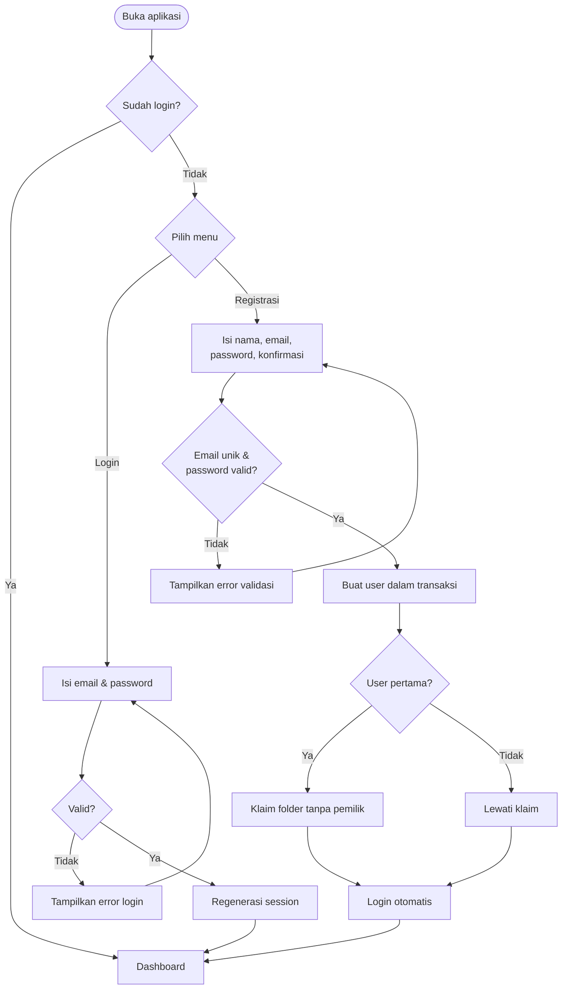
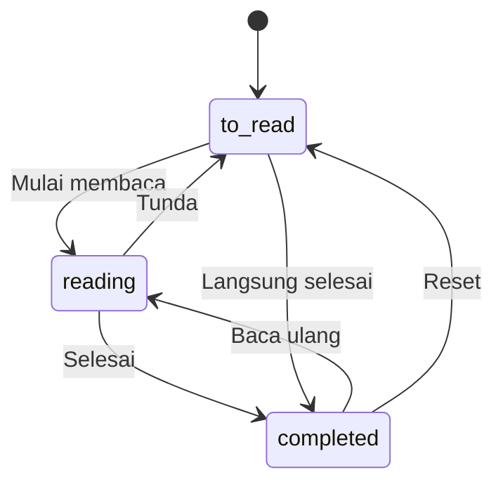
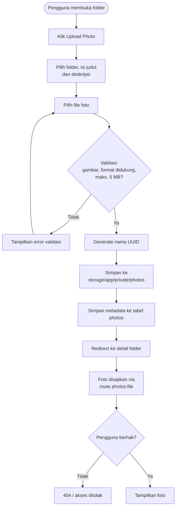
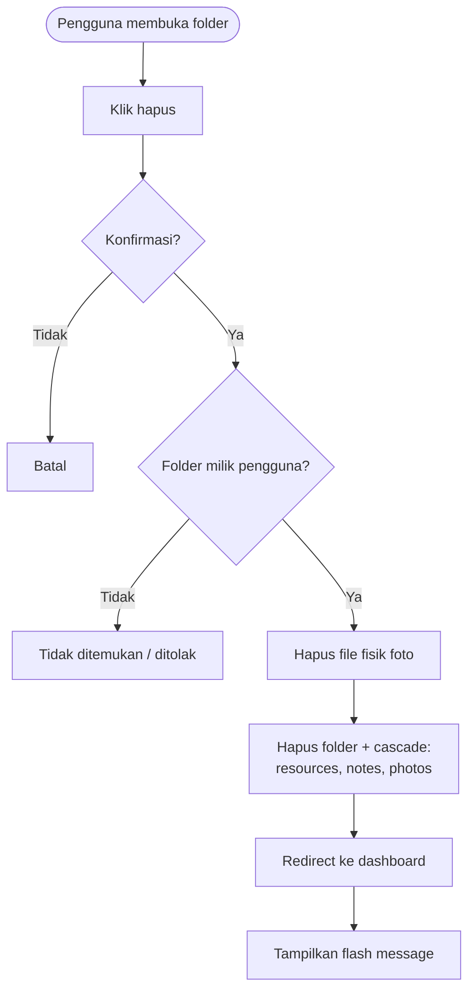
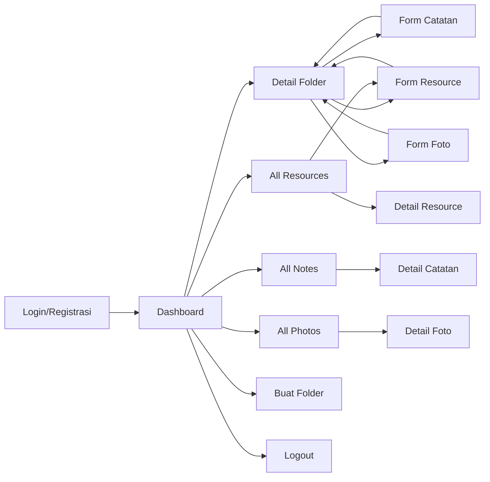
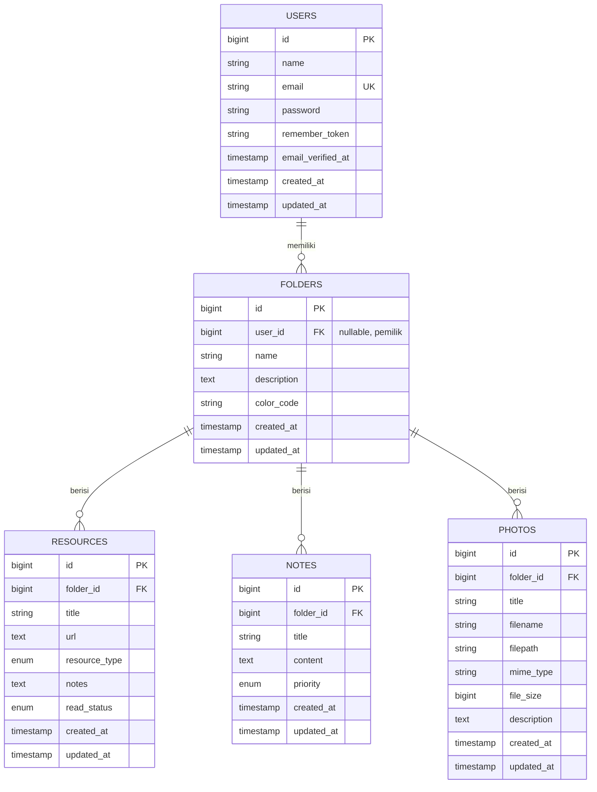

# Product Requirements Document (PRD)

## FolderIn — Knowledge & Context Bookmark Manager

| Atribut | Keterangan |
| --- | --- |
| Nama produk | FolderIn |
| Jenis produk | Aplikasi web manajemen pengetahuan pribadi |
| Versi dokumen | 1.0 |
| Status | Draft / MVP |
| Tanggal | 4 November 2026 |
| Platform | Web (desktop dan mobile browser) |
| Teknologi | Laravel 12, Blade, MySQL/SQLite, Tailwind CSS |
| Pemilik produk | Tim FolderIn |
| Dokumen terkait | [`README.md`](../README.md) |

---

## Daftar Isi

1. [Ringkasan Eksekutif](#1-ringkasan-eksekutif)
2. [Latar Belakang dan Masalah](#2-latar-belakang-dan-masalah)
3. [Tujuan Produk](#3-tujuan-produk)
4. [Analisis Kebutuhan](#4-analisis-kebutuhan)
5. [Ruang Lingkup](#5-ruang-lingkup)
6. [Fitur Utama](#6-fitur-utama)
7. [Role dan Hak Akses](#7-role-dan-hak-akses)
8. [Alur Pengguna dan Flowchart](#8-alur-pengguna-dan-flowchart)
9. [Model Data](#9-model-data)
10. [Aturan Bisnis dan Validasi](#10-aturan-bisnis-dan-validasi)
11. [Kebutuhan Non-Fungsional](#11-kebutuhan-non-fungsional)
12. [Kriteria Penerimaan](#12-kriteria-penerimaan)
13. [Status Implementasi Saat Ini](#13-status-implementasi-saat-ini)
14. [Risiko dan Mitigasi](#14-risiko-dan-mitigasi)
15. [Roadmap](#15-roadmap)
16. [Glosarium](#16-glosarium)

---

## 1. Ringkasan Eksekutif

FolderIn adalah aplikasi web untuk menyimpan dan mengelola resource belajar dalam folder pribadi. Berbeda dari bookmark manager biasa, FolderIn menyimpan konteks resource: jenis resource, status baca, catatan pribadi, dan foto pendukung seperti screenshot atau diagram.

Produk menyasar pelajar, mahasiswa, developer, peneliti, dan profesional yang sering mengumpulkan tautan dari berbagai sumber tetapi kesulitan menemukannya kembali. FolderIn menyatukan tautan, catatan, dan foto dalam satu tempat, dengan isolasi data per pengguna.

MVP saat ini berfokus pada:

- Autentikasi akun.
- Folder pribadi.
- Bookmark/resource dengan status baca.
- Catatan dengan prioritas.
- Foto privat.
- Pencarian dan filter dasar.
- Dashboard ringkasan.

---

## 2. Latar Belakang dan Masalah

### 2.1 Konteks

Resource digital tersebar di banyak kanal: browser bookmark, grup chat, email, dokumen, dan aplikasi catatan. Akibatnya, tautan yang pernah dianggap penting sering hilang atau kehilangan konteks.

### 2.2 Masalah Utama

| Kode | Masalah | Dampak |
| --- | --- | --- |
| P-01 | Bookmark tersebar di banyak aplikasi | Sulit mencari kembali resource yang pernah disimpan |
| P-02 | Bookmark tidak menyimpan alasan penyimpanan | Pengguna lupa mengapa tautan itu penting |
| P-03 | Status baca tidak terlacak | Pengguna tidak tahu mana yang sudah/belum dipelajari |
| P-04 | Catatan dan screenshot terpisah dari tautan | Konteks belajar hilang |
| P-05 | Data pribadi berisiko terlihat pengguna lain | Masalah privasi dan kepercayaan |
| P-06 | Tidak ada struktur pengelompokan yang fleksibel | Resource bercampur dan sulit diprioritaskan |

### 2.3 Peluang

Menyediakan satu aplikasi ringan berbasis web yang:

- Mengelompokkan resource per topik.
- Menyimpan konteks dalam bentuk catatan, status, dan foto.
- Menjaga privasi melalui akun dan isolasi data.
- Tetap mudah dipakai tanpa konfigurasi rumit.

---

## 3. Tujuan Produk

### 3.1 Tujuan Bisnis

1. Menyediakan produk MVP yang dapat digunakan untuk mengelola resource belajar secara pribadi.
2. Menjadi dasar pengembangan produk knowledge management yang lebih besar.
3. Memenuhi kebutuhan proyek USK dengan dokumentasi produk dan teknis yang lengkap.

### 3.2 Tujuan Pengguna

1. Menyimpan resource belajar dalam folder yang terstruktur.
2. Menemukan resource kembali dengan cepat melalui pencarian dan filter.
3. Melacak status baca resource.
4. Menyimpan catatan dan foto pendukung di tempat yang sama.
5. Memastikan data pribadi tidak dapat diakses pengguna lain.

### 3.3 Metrik Keberhasilan

| Metrik | Target MVP | Cara Ukur |
| --- | --- | --- |
| Pengguna dapat menyelesaikan registrasi dan login | ≥ 95% percobaan valid | Log aplikasi/manual UAT |
| Pengguna dapat membuat folder dan resource pertama | ≥ 90% pengguna baru | Data database |
| Waktu menemukan resource melalui pencarian | < 30 detik | UAT |
| Kebocoran data antar pengguna | 0 kejadian | Test otorisasi dan audit |
| Waktu muat halaman utama | < 2 detik pada data ≤ 1.000 resource | Pengukuran browser |
| UAT fitur inti lulus | 100% kriteria wajib | Checklist UAT |

> Metrik di atas adalah target MVP, bukan hasil pengukuran produksi.

---

## 4. Analisis Kebutuhan

### 4.1 Stakeholder

| Stakeholder | Kepentingan |
| --- | --- |
| Pengguna akhir | Mengelola resource pribadi dengan mudah dan aman |
| Pemilik produk | Memastikan produk sesuai kebutuhan dan siap dikembangkan |
| Developer | Memahami requirement, batasan, dan kriteria penerimaan |
| Dosen/penguji | Menilai kelengkapan analisis, ruang lingkup, fitur, role, dan alur |
| Administrator sistem | Menjaga server, database, dan penyimpanan file |

### 4.2 Persona

#### Persona 1 — Mahasiswa

- Nama: Raka
- Usia: 20 tahun
- Kebutuhan: Menyimpan tautan materi kuliah, jurnal, dan video pembelajaran.
- Masalah: Tautan tersebar di chat kampus dan browser.
- Harapan: Bisa mengelompokkan materi per mata kuliah dan menandai mana yang sudah dipelajari.

#### Persona 2 — Developer

- Nama: Dina
- Usia: 26 tahun
- Kebutuhan: Menyimpan dokumentasi, repository, artikel, dan screenshot error.
- Masalah: Bookmark teknis menumpuk tanpa catatan konteks.
- Harapan: Bisa mencari berdasarkan judul, URL, atau catatan, serta memindahkan resource antar folder proyek.

#### Persona 3 — Peneliti/Profesional

- Nama: Bima
- Usia: 32 tahun
- Kebutuhan: Menyimpan referensi, ringkasan, dan foto dokumen.
- Masalah: Referensi dan catatan tersimpan di aplikasi berbeda.
- Harapan: Data privat, terstruktur, dan mudah dicari.

### 4.3 Kebutuhan Fungsional

Prioritas memakai MoSCoW: **M** = Must have, **S** = Should have, **C** = Could have.

| Kode | Kebutuhan | Prioritas | Status MVP |
| --- | --- | --- | --- |
| FR-01 | Pengguna dapat mendaftar dengan nama, email, dan password | M | Selesai |
| FR-02 | Pengguna dapat login dengan email dan password serta opsi remember me | M | Selesai |
| FR-03 | Pengguna dapat logout dengan aman | M | Selesai |
| FR-04 | Sistem membatasi percobaan login/registrasi maksimal 6 per menit | S | Selesai |
| FR-05 | Pengguna melihat dashboard berisi daftar folder dan ringkasan | M | Selesai |
| FR-06 | Pengguna dapat membuat folder dengan nama, deskripsi, dan warna | M | Selesai |
| FR-07 | Pengguna dapat melihat detail folder beserta resource, catatan, dan foto | M | Selesai |
| FR-08 | Pengguna dapat mengubah dan menghapus folder miliknya | M | Selesai |
| FR-09 | Pengguna dapat menambah resource ke folder miliknya | M | Selesai |
| FR-10 | Pengguna dapat mengubah dan menghapus resource miliknya | M | Selesai |
| FR-11 | Pengguna dapat mengubah status baca resource dengan cepat | M | Selesai |
| FR-12 | Pengguna dapat memindahkan resource ke folder lain miliknya | S | Selesai |
| FR-13 | Pengguna dapat mencari resource berdasarkan judul, URL, dan catatan | M | Selesai |
| FR-14 | Pengguna dapat memfilter resource berdasarkan folder, jenis, dan status | S | Selesai |
| FR-15 | Pengguna dapat membuat catatan dengan judul, isi, dan prioritas | M | Selesai |
| FR-16 | Pengguna dapat mengubah dan menghapus catatan miliknya | M | Selesai |
| FR-17 | Pengguna dapat mencari dan memfilter catatan | S | Selesai |
| FR-18 | Pengguna dapat mengunggah foto ke folder miliknya | M | Selesai |
| FR-19 | Pengguna dapat mengganti dan menghapus foto miliknya | M | Selesai |
| FR-20 | Foto hanya dapat diakses pengguna yang berhak | M | Selesai |
| FR-21 | Sistem mengisolasi seluruh data berdasarkan pemilik folder | M | Selesai |
| FR-22 | Pengguna pertama mengklaim folder lama tanpa pemilik | C | Selesai |
| FR-23 | Antarmuka mendukung mode terang/gelap dan responsif | C | Selesai |
| FR-24 | Sistem menampilkan pesan sukses/error setelah aksi | S | Selesai |
| FR-25 | Pengguna dapat melihat halaman daftar semua resource | S | Selesai |
| FR-26 | Pengguna dapat melihat halaman daftar semua catatan | S | Selesai |
| FR-27 | Pengguna dapat melihat halaman daftar semua foto | S | Selesai |
| FR-28 | Pengguna dapat melihat halaman detail resource/catatan/foto | C | Selesai |
| FR-29 | Pengguna dapat mengelola profil dan mengganti password | C | Belum |
| FR-30 | Pengguna dapat mereset password melalui email | C | Belum |
| FR-31 | Admin dapat mengelola pengguna dan konten | C | Belum |

### 4.4 Kebutuhan Non-Fungsional

| Kode | Kategori | Kebutuhan |
| --- | --- | --- |
| NFR-01 | Keamanan | Password disimpan sebagai hash, bukan teks biasa |
| NFR-02 | Keamanan | Semua form mutasi memakai CSRF token |
| NFR-03 | Keamanan | Route aplikasi hanya dapat diakses pengguna terautentikasi |
| NFR-04 | Keamanan | Setiap query data dibatasi pada pemilik folder |
| NFR-05 | Keamanan | File foto disajikan melalui route terautentikasi |
| NFR-06 | Privasi | Pengguna tidak dapat melihat, mengubah, atau menghapus data pengguna lain |
| NFR-07 | Performa | Halaman daftar memakai pagination untuk membatasi jumlah data |
| NFR-08 | Performa | Resource dan relasi folder dimuat dengan eager loading untuk mengurangi N+1 query |
| NFR-09 | Usability | Antarmuka responsif pada lebar desktop dan mobile |
| NFR-10 | Usability | Aksi destruktif meminta konfirmasi |
| NFR-11 | Usability | Error validasi ditampilkan dekat field terkait |
| NFR-12 | Kompatibilitas | Berjalan pada Chrome, Firefox, Edge, dan Safari versi modern |
| NFR-13 | Kompatibilitas | Mendukung MySQL/MariaDB dan SQLite |
| NFR-14 | Maintainability | Mengikuti struktur MVC dan konvensi Laravel |
| NFR-15 | Maintainability | Validasi dipisahkan dalam Form Request |
| NFR-16 | Reliabilitas | Registrasi dan pengklaiman folder berjalan dalam transaksi |
| NFR-17 | Portabilitas | Konfigurasi sensitif disimpan di `.env` |
| NFR-18 | Aksesibilitas | Form memiliki label, fokus terlihat, dan kontras teks memadai |
| NFR-19 | Operasional | Database dan folder storage dapat dibackup secara berkala |
| NFR-20 | Skalabilitas | Struktur data memungkinkan penambahan tag, favorit, dan berbagi di masa depan |
| NFR-21 | Performa | Statistik folder dihitung dengan query agregat (`withCount`), tab folder dipaginasi terpisah, dan query utama didukung indeks database |

### 4.5 Asumsi

1. Pengguna memiliki browser modern dan koneksi internet.
2. Satu akun mewakili satu ruang kerja pribadi.
3. Pengguna bertanggung jawab atas isi resource yang disimpan.
4. Aplikasi dijalankan pada server dengan PHP 8.2+.
5. Tidak ada kebutuhan kolaborasi real-time pada MVP.
6. Tidak ada kebutuhan integrasi dengan layanan pihak ketiga pada MVP.

### 4.6 Dependensi

- Laravel 12 dan ekosistem Composer.
- Database MySQL/MariaDB atau SQLite.
- Filesystem lokal untuk foto.
- Tailwind CSS dikompilasi melalui Vite; Font Awesome dimuat dari CDN.
- Ekstensi PHP `pdo_mysql` atau `pdo_sqlite`.

### 4.7 Batasan

- Aplikasi berbasis web, belum ada aplikasi mobile native.
- Hanya ada satu role pengguna pada MVP.
- Pencarian memakai `LIKE`, belum full-text search.
- Tidak ada API publik.
- Tidak ada email transaksional untuk reset password atau verifikasi.
- Ikon Font Awesome masih bergantung pada CDN.

---

## 5. Ruang Lingkup

### 5.1 In Scope (MVP)

- Autentikasi: registrasi, login, logout, remember me.
- Manajemen folder pribadi.
- Manajemen resource/bookmark.
- Status baca resource.
- Pindah resource antar folder.
- Pencarian dan filter resource.
- Manajemen catatan dengan prioritas.
- Pencarian dan filter catatan.
- Upload, ganti, hapus, dan penyajian foto privat.
- Dashboard ringkasan.
- Isolasi data per pengguna.
- Dark mode dan tampilan responsif.
- Validasi form dan flash message.
- Test dasar autentikasi dan kepemilikan data.

### 5.2 Out of Scope (MVP)

- Role admin dan panel administrasi.
- Berbagi folder atau resource ke pengguna lain.
- Kolaborasi real-time.
- Komentar pada resource.
- Tag dan kategori lintas folder.
- Favorit/pin.
- Import/export bookmark.
- Sinkronisasi browser bookmark.
- Aplikasi mobile native.
- Notifikasi email/push.
- Reset password dan verifikasi email.
- Two-factor authentication.
- API publik.
- Full-text search.
- Object storage S3 untuk produksi.
- Audit log.
- Analitik penggunaan.
- Integrasi AI/LLM.
- Pembayaran atau langganan.

### 5.3 Di Luar Batas tetapi Direncanakan

Item berikut tidak termasuk MVP, tetapi struktur produk disiapkan untuk mendukungnya:

- Tag dan pencarian global.
- Berbagi folder.
- Panel admin.
- Import/export.
- PWA.

---

## 6. Fitur Utama

### 6.1 Modul Autentikasi

**Tujuan:** Memastikan hanya pengguna terdaftar yang dapat mengakses data pribadi.

**Fitur:**

- Form registrasi: nama, email, password, konfirmasi password.
- Form login: email, password, remember me.
- Logout.
- Rate limiting 6 percobaan per menit.
- Session regeneration setelah login/registrasi.
- Pengklaiman folder lama oleh pengguna pertama.

**Aturan:**

- Email harus unik.
- Password minimal 8 karakter dan harus sama dengan konfirmasi.
- Pesan error login tidak mengungkap apakah email atau password yang salah.
- Pengguna yang sudah login tidak dapat membuka halaman login/registrasi.

**Acceptance criteria:**

- Pengguna baru dapat mendaftar dan langsung masuk ke dashboard.
- Pengguna dapat login dengan kredensial valid.
- Kredensial salah menampilkan pesan error.
- Logout mengakhiri session dan mengarahkan ke halaman login.

### 6.2 Modul Folder

**Tujuan:** Menjadi wadah utama pengelompokan resource.

**Fitur:**

- Daftar folder pada dashboard.
- Buat folder.
- Lihat detail folder.
- Ubah folder.
- Hapus folder.
- Warna folder.
- Statistik jumlah item.

**Aturan:**

- Nama folder wajib diisi.
- Warna harus hex 6 digit.
- Folder baru otomatis menjadi milik pengguna yang membuat.
- Menghapus folder menghapus seluruh resource, catatan, dan metadata foto.
- File foto perlu dibersihkan secara eksplisit (lihat risiko).

**Acceptance criteria:**

- Folder baru muncul di dashboard pembuat.
- Folder tidak muncul di dashboard pengguna lain.
- Folder dapat diubah dan dihapus.
- Detail folder menampilkan tab resource, catatan, dan foto.

### 6.3 Modul Resource/Bookmark

**Tujuan:** Menyimpan tautan beserta konteks dan status baca.

**Fitur:**

- Tambah resource.
- Daftar semua resource.
- Cari resource.
- Filter resource.
- Ubah resource.
- Ubah status baca.
- Pindah folder.
- Hapus resource.

**Aturan:**

- URL harus valid.
- Resource harus berada di folder milik pengguna.
- Jenis resource dibatasi pada lima nilai.
- Status baca dibatasi pada tiga nilai.
- Resource yang dipindahkan harus tetap berada di folder milik pengguna.

**Acceptance criteria:**

- Resource baru tampil di folder tujuan.
- Status baca dapat diubah tanpa membuka form edit.
- Resource dapat dipindahkan ke folder lain milik pengguna.
- Resource tidak dapat dipindahkan ke folder pengguna lain.
- Pencarian dan filter menampilkan hasil yang sesuai.

### 6.4 Modul Catatan

**Tujuan:** Menyimpan pemikiran, ringkasan, dan konteks tambahan.

**Fitur:**

- Tambah catatan.
- Daftar catatan.
- Cari catatan.
- Filter prioritas dan folder.
- Ubah catatan.
- Hapus catatan.

**Aturan:**

- Judul dan isi wajib diisi.
- Prioritas dibatasi pada `low`, `medium`, `high`.
- Catatan harus berada di folder milik pengguna.

**Acceptance criteria:**

- Catatan tampil di tab Notes pada detail folder.
- Catatan dapat diubah dan dihapus.
- Prioritas memengaruhi badge dan indikator warna.
- Catatan pengguna lain tidak dapat diakses.

### 6.5 Modul Foto

**Tujuan:** Menyimpan gambar pendukung seperti screenshot, diagram, atau wireframe.

**Fitur:**

- Upload foto.
- Preview foto.
- Ganti foto.
- Hapus foto.
- Sajikan foto secara privat.

**Aturan:**

- Format: JPEG, JPG, PNG, GIF, WEBP.
- Maksimal 5 MB.
- File disimpan dengan nama UUID.
- File disimpan di `storage/app/private/photos`.
- Metadata disimpan di tabel `photos`.
- Akses file melalui route `photos.file` setelah login.

**Acceptance criteria:**

- Foto berhasil diunggah dan tampil di detail folder.
- Foto tidak dapat diakses tanpa login.
- Foto pengguna lain tidak dapat diakses.
- Mengganti foto menghapus file lama.
- Menghapus foto menghapus metadata dan file.

### 6.6 Modul Dashboard dan Navigasi

**Tujuan:** Memberikan ringkasan dan akses cepat ke fitur utama.

**Fitur:**

- Grid folder.
- Ringkasan total folder, total resource, rata-rata resource per folder, dan folder kosong.
- Navigasi ke dashboard, semua resource, dan folder baru.
- Nama pengguna dan tombol logout.
- Dark mode.
- Menu mobile.

**Acceptance criteria:**

- Dashboard hanya menampilkan data pengguna yang login.
- Statistik sesuai dengan data yang terlihat.
- Navigasi dapat digunakan pada desktop dan mobile.

### 6.7 Modul Keamanan dan Kepemilikan

**Tujuan:** Menjamin data pribadi tidak bocor.

**Fitur:**

- Middleware `auth` dan `guest`.
- Global scope kepemilikan.
- Validasi kepemilikan folder pada input.
- Penyajian file privat.
- CSRF.
- Password hashing.
- Rate limiting.

**Acceptance criteria:**

- Guest tidak dapat membuka route aplikasi.
- Pengguna tidak dapat melihat folder/resource/catatan/foto pengguna lain.
- Pengguna tidak dapat membuat data di folder pengguna lain.
- Akses file foto pengguna lain gagal.
- Semua test kepemilikan lulus.

---

## 7. Role dan Hak Akses

### 7.1 Definisi Role

| Role | Deskripsi | Status |
| --- | --- | --- |
| **Guest** | Pengunjung yang belum login. Hanya dapat membuka halaman login dan registrasi. | Aktif |
| **User** | Pengguna terdaftar. Dapat mengelola seluruh data miliknya sendiri. | Aktif |
| **Admin** | Pengelola sistem dengan akses ke seluruh data dan manajemen pengguna. | Tidak termasuk MVP |
| **System** | Proses internal aplikasi: global scope, validasi, penyajian file, dan cascade data. | Aktif (non-aktor) |

> FolderIn saat ini **tidak memiliki role admin**. Jangan mengasumsikan adanya akses administrator pada implementasi MVP.

### 7.2 Matriks Akses

Keterangan:

- ✅ = diizinkan
- ❌ = tidak diizinkan
- ➖ = tidak berlaku
- 🔒 = hanya untuk data miliknya sendiri

| Area/Aksi | Guest | User (pemilik) | User (bukan pemilik) | Admin (future) |
| --- | --- | --- | --- | --- |
| Membuka halaman login | ✅ | ❌ (redirect) | ❌ (redirect) | ✅ |
| Membuka halaman registrasi | ✅ | ❌ (redirect) | ❌ (redirect) | ✅ |
| Registrasi akun | ✅ | ➖ | ➖ | ➖ |
| Login | ✅ | ➖ | ➖ | ✅ |
| Logout | ❌ | ✅ | ✅ | ✅ |
| Melihat dashboard | ❌ | 🔒 | 🔒 (hanya data sendiri) | ✅ semua |
| Melihat daftar folder | ❌ | 🔒 | 🔒 | ✅ semua |
| Membuat folder | ❌ | ✅ | ✅ (folder sendiri) | ✅ |
| Melihat detail folder | ❌ | 🔒 | ❌ | ✅ semua |
| Mengubah folder | ❌ | 🔒 | ❌ | ✅ semua |
| Menghapus folder | ❌ | 🔒 | ❌ | ✅ semua |
| Melihat resource | ❌ | 🔒 | ❌ | ✅ semua |
| Menambah resource | ❌ | 🔒 | ❌ (hanya folder sendiri) | ✅ semua |
| Mengubah resource | ❌ | 🔒 | ❌ | ✅ semua |
| Menghapus resource | ❌ | 🔒 | ❌ | ✅ semua |
| Mengubah status baca | ❌ | 🔒 | ❌ | ✅ semua |
| Memindahkan resource | ❌ | 🔒 (folder sendiri) | ❌ | ✅ semua |
| Mencari/filter resource | ❌ | 🔒 | 🔒 (hasil sendiri) | ✅ semua |
| Melihat catatan | ❌ | 🔒 | ❌ | ✅ semua |
| Menambah catatan | ❌ | 🔒 | ❌ (hanya folder sendiri) | ✅ semua |
| Mengubah catatan | ❌ | 🔒 | ❌ | ✅ semua |
| Menghapus catatan | ❌ | 🔒 | ❌ | ✅ semua |
| Mencari/filter catatan | ❌ | 🔒 | 🔒 (hasil sendiri) | ✅ semua |
| Melihat foto | ❌ | 🔒 | ❌ | ✅ semua |
| Mengunggah foto | ❌ | 🔒 | ❌ (hanya folder sendiri) | ✅ semua |
| Mengganti foto | ❌ | 🔒 | ❌ | ✅ semua |
| Menghapus foto | ❌ | 🔒 | ❌ | ✅ semua |
| Mengakses file foto via URL | ❌ | 🔒 | ❌ | ✅ semua |
| Mengelola pengguna | ❌ | ❌ | ❌ | ✅ |
| Melihat audit log | ❌ | ❌ | ❌ | ✅ (future) |

### 7.3 Mekanisme Otorisasi

Prinsip utama:

1. **Deny by default** — route aplikasi tertutup untuk guest.
2. **Ownership by relation** — data anak mengikuti pemilik folder.
3. **Validate foreign key ownership** — `folder_id` tidak cukup hanya `exists`, tetapi harus milik pengguna.
4. **Serve files through authorization** — file foto tidak diekspos sebagai URL publik.
5. **Least privilege** — tidak ada role admin pada MVP.

---

## 8. Alur Pengguna dan Flowchart

### 8.1 Flowchart Utama

### 8.2 Alur Registrasi dan Login

### 8.3 Alur Status Resource

Status dapat diubah kapan saja melalui dropdown pada daftar resource. Tidak ada aturan transisi yang kaku; status adalah penanda, bukan state machine yang mengunci.

### 8.4 Alur Upload Foto

### 8.5 Alur Hapus Folder

> Catatan implementasi: event `deleting` pada model `Folder` menghapus file fisik setiap foto terlebih dahulu, lalu cascade database menghapus baris `resources`, `notes`, dan `photos`.

### 8.6 Peta Navigasi

---

## 9. Model Data

### 9.1 ERD

### 9.2 Relasi

| Relasi | Kardinalitas | Aturan |
| --- | --- | --- |
| User → Folder | 1 : N | Satu pengguna memiliki banyak folder |
| Folder → Resource | 1 : N | Satu folder berisi banyak resource |
| Folder → Note | 1 : N | Satu folder berisi banyak catatan |
| Folder → Photo | 1 : N | Satu folder berisi banyak foto |
| User → Resource/Note/Photo | 1 : N (tidak langsung) | Kepemilikan diturunkan dari folder |

### 9.3 Enum

| Tabel | Kolom | Nilai |
| --- | --- | --- |
| `resources` | `resource_type` | `documentation`, `article`, `repository`, `video`, `other` |
| `resources` | `read_status` | `to_read`, `reading`, `completed` |
| `notes` | `priority` | `low`, `medium`, `high` |

### 9.4 Integritas Data

- Foreign key `folder_id` memakai `ON DELETE CASCADE`.
- Foreign key `user_id` memakai `ON DELETE CASCADE`.
- `user_id` nullable hanya untuk kompatibilitas folder lama.
- `color_code` memiliki default `#3B82F6`.
- `filepath` menyimpan path relatif di disk.
- `file_size` disimpan dalam byte.

---

## 10. Aturan Bisnis dan Validasi

### 10.1 Aturan Bisnis

| Kode | Aturan |
| --- | --- |
| BR-01 | Setiap folder baru otomatis dimiliki pengguna yang membuatnya |
| BR-02 | Folder lama tanpa pemilik diklaim oleh pengguna pertama yang registrasi |
| BR-03 | Folder pengguna kedua dan seterusnya tidak mengklaim folder lama |
| BR-04 | Resource, catatan, dan foto hanya boleh berada di folder milik pengguna |
| BR-05 | Menghapus folder menghapus seluruh data anak |
| BR-06 | Resource dapat dipindahkan hanya ke folder milik pengguna yang sama |
| BR-07 | Status baca resource dapat diubah kapan saja |
| BR-08 | Foto baru disimpan privat dan diakses melalui route terautentikasi |
| BR-09 | Mengganti foto menghapus file lama |
| BR-10 | Menghapus foto menghapus metadata dan file |
| BR-11 | Email pengguna harus unik |
| BR-12 | Password minimal 8 karakter dan harus dikonfirmasi |
| BR-13 | Nama folder dan judul resource/catatan/foto maksimal 255 karakter |
| BR-14 | URL resource harus valid dan maksimal 2.048 karakter |
| BR-15 | Foto maksimal 5 MB dan hanya format gambar yang didukung |

### 10.2 Validasi Input

| Form | Field | Aturan |
| --- | --- | --- |
| Registrasi | `name` | required, string, max 255 |
| Registrasi | `email` | required, email, max 255, unique |
| Registrasi | `password` | required, string, min 8, confirmed |
| Login | `email` | required, email |
| Login | `password` | required, string |
| Folder | `name` | required, string, max 255 |
| Folder | `description` | nullable, string, max 1.000 |
| Folder | `color_code` | nullable, regex hex 6 digit |
| Resource | `folder_id` | required, integer, exists milik user |
| Resource | `title` | required, string, max 255 |
| Resource | `url` | required, url, max 2.048 |
| Resource | `resource_type` | required, enum |
| Resource | `notes` | nullable, string, max 5.000 |
| Resource | `read_status` | required, enum |
| Catatan | `folder_id` | required, integer, exists milik user |
| Catatan | `title` | required, string, max 255 |
| Catatan | `content` | required, string, max 50.000 |
| Catatan | `priority` | required, enum |
| Foto | `folder_id` | required, integer, exists milik user |
| Foto | `title` | required, string, max 255 |
| Foto | `photo` | required saat create, nullable saat update, image, mimes, max 5.120 KB |
| Foto | `description` | nullable, string, max 1.000 |

### 10.3 Format Pesan Error

Pesan error harus:

- Spesifik dan mudah dipahami.
- Tidak mengungkap informasi sensitif.
- Ditampilkan di dekat field terkait.
- Menggunakan bahasa yang konsisten.

Contoh:

- "The folder name is required."
- "Please enter a valid URL (e.g., https://example.com)."
- "The photo size must not exceed 5MB."

---

## 11. Kebutuhan Non-Fungsional

### 11.1 Keamanan

- Gunakan HTTPS pada produksi.
- Set `APP_DEBUG=false` pada produksi.
- Jangan commit `.env`.
- Gunakan password database yang kuat.
- Batasi akses langsung ke folder `storage`.
- Terapkan backup terenkripsi jika menyimpan data sensitif.
- Lakukan audit dependency secara berkala (`composer audit`, `npm audit`).

### 11.2 Privasi

- Data pengguna tidak boleh diakses pengguna lain.
- File foto tidak boleh memiliki URL publik permanen.
- Log aplikasi tidak boleh mencatat password atau token.
- Hapus data pengguna secara menyeluruh jika fitur hapus akun ditambahkan.

### 11.3 Performa

- Pagination wajib untuk daftar besar.
- Gunakan eager loading untuk relasi yang ditampilkan.
- Gunakan agregasi SQL (`withCount`) untuk statistik, bukan memuat seluruh relasi ke PHP.
- Index database telah ditambahkan untuk kolom filter dan urutan yang sering dipakai.
- Optimalkan query pencarian jika memakai full-text search.
- Cache asset statis pada produksi dan gunakan hasil build Vite.

### 11.4 Usability

- Navigasi utama maksimal satu klik dari dashboard.
- Aksi destruktif memakai konfirmasi.
- Form menampilkan error inline.
- Antarmuka konsisten antara mode terang dan gelap.
- Tombol dan tautan memiliki label yang jelas.

### 11.5 Kompatibilitas

- Browser: Chrome, Firefox, Edge, Safari versi modern.
- Database: MySQL 8+, MariaDB 10+, SQLite 3.
- PHP: 8.2, 8.3, 8.4.
- Resolusi: mobile 360 px hingga desktop 1920 px.

### 11.6 Maintainability

- Ikuti PSR-12 dan Laravel Pint.
- Pisahkan validasi ke Form Request.
- Gunakan nama route dan controller yang konsisten.
- Tambahkan test untuk setiap fitur baru.
- Dokumentasikan perubahan skema database.

### 11.7 Operasional

- Backup database harian.
- Backup storage foto harian.
- Monitor disk usage.
- Monitor log error.
- Sediakan prosedur restore.

---

## 12. Kriteria Penerimaan

### 12.1 UAT Checklist

> Kolom **Status** menunjukkan ketersediaan fitur pada implementasi saat ini, bukan hasil pengujian formal. Pengujian UAT tetap perlu dilakukan sebelum rilis.

| No | Skenario | Hasil yang Diharapkan | Status |
| --- | --- | --- | --- |
| UAT-01 | Guest membuka `/` | Redirect ke halaman login | ✅ |
| UAT-02 | Guest membuka `/folders` | Redirect ke halaman login | ✅ |
| UAT-03 | Guest membuka `/login` dan `/register` | Halaman tampil | ✅ |
| UAT-04 | Registrasi dengan email baru | Akun dibuat dan login otomatis | ✅ |
| UAT-05 | Registrasi dengan email duplikat | Error validasi | ✅ |
| UAT-06 | Login dengan kredensial valid | Masuk ke dashboard | ✅ |
| UAT-07 | Login dengan kredensial salah | Error, tidak masuk | ✅ |
| UAT-08 | Logout | Session berakhir, redirect ke login | ✅ |
| UAT-09 | Buat folder | Folder muncul di dashboard | ✅ |
| UAT-10 | Edit folder | Perubahan tersimpan | ✅ |
| UAT-11 | Hapus folder | Folder dan data anak terhapus | ✅ |
| UAT-12 | Buat resource | Resource muncul di folder | ✅ |
| UAT-13 | Ubah status baca | Status berubah | ✅ |
| UAT-14 | Pindah resource | Resource muncul di folder tujuan | ✅ |
| UAT-15 | Cari/filter resource | Hasil sesuai kriteria | ✅ |
| UAT-16 | Buat/edit/hapus catatan | Perubahan tersimpan | ✅ |
| UAT-17 | Upload foto valid | Foto tampil di folder | ✅ |
| UAT-18 | Upload foto > 5 MB | Error validasi | ✅ |
| UAT-19 | Upload format tidak didukung | Error validasi | ✅ |
| UAT-20 | Akses foto tanpa login | Ditolak/redirect | ✅ |
| UAT-21 | Akses folder pengguna lain | Tidak ditemukan/redirect | ✅ |
| UAT-22 | Buat resource di folder pengguna lain | Error validasi | ✅ |
| UAT-23 | Buka `/notes` | Halaman daftar catatan tampil | ✅ |
| UAT-24 | Buka `/photos` | Halaman daftar foto tampil | ✅ |
| UAT-25 | Buka `/resources/{id}` | Halaman detail resource tampil | ✅ |
| UAT-26 | Hapus folder berisi foto | File foto ikut terhapus | ✅ |

### 12.2 Definisi "Selesai" (Definition of Done)

Sebuah fitur dianggap selesai jika:

1. Requirement dan acceptance criteria terpenuhi.
2. Validasi input tersedia.
3. Otorisasi kepemilikan diterapkan.
4. UI responsif dan memiliki feedback.
5. Tidak ada error kritis di log.
6. Test terkait lulus.
7. Dokumentasi diperbarui.

---

## 13. Status Implementasi Saat Ini

### 13.1 Ringkasan

| Modul | Backend | UI | Catatan |
| --- | --- | --- | --- |
| Autentikasi | ✅ | ✅ | Registrasi, login, logout, throttle |
| Dashboard | ✅ | ✅ | Statistik folder dan resource |
| Folder CRUD | ✅ | ✅ | Lengkap |
| Resource CRUD | ✅ | ✅ | Index/create/edit/detail lengkap |
| Status resource | ✅ | ✅ | Dropdown cepat |
| Pindah resource | ✅ | ✅ | Modal pada detail folder |
| Pencarian/filter resource | ✅ | ✅ | Judul, URL, notes, folder, tipe, status |
| Catatan CRUD | ✅ | ✅ | Index/create/edit/detail lengkap |
| Pencarian/filter catatan | ✅ | ✅ | Judul, isi, folder, prioritas |
| Foto CRUD | ✅ | ✅ | Index/create/edit/detail/upload/ganti/hapus |
| Foto privat | ✅ | ✅ | Route `photos.file` |
| Pembersihan file foto | ✅ | ➖ | Event `deleting` pada model Folder |
| Isolasi data | ✅ | ✅ | Global scope + validasi |
| Optimasi performa | ✅ | ✅ | `withCount`, pagination per tab, indeks database |
| Asset build | ✅ | ✅ | Tailwind via Vite, fallback CDN |
| Dark mode | ➖ | ✅ | Client-side |
| Responsif | ➖ | ✅ | Tailwind |
| Test kepemilikan | ✅ | ➖ | Perlu `pdo_sqlite` |

### 13.2 Gap yang Diketahui

1. Belum ada role admin.
2. Belum ada reset password, verifikasi email, dan manajemen profil.
3. Test CRUD dan test akses file foto belum lengkap.
4. `phpunit.xml` memakai SQLite in-memory, sedangkan environment pengembangan saat ini belum memiliki `pdo_sqlite`; test bawaan gagal dengan `could not find driver`. Suite sudah diverifikasi lulus memakai database MySQL terpisah (6 test, 18 assertion).
5. File foto lama yang sudah terlanjur orphan sebelum perbaikan belum dibersihkan otomatis; perlu job/skrip pembersihan sekali jalan.
6. Ikon Font Awesome masih dimuat dari CDN.

---

## 14. Risiko dan Mitigasi

| Kode | Risiko | Dampak | Probabilitas | Mitigasi |
| --- | --- | --- | --- | --- |
| R-01 | Data pengguna bocor karena query tanpa scope | Tinggi | Rendah | Global scope, validasi ownership, test otorisasi |
| R-02 | File foto dapat diakses tanpa login | Tinggi | Rendah | Route privat, middleware auth, test akses file |
| R-03 | File foto orphan (terutama data lama) | Sedang | Rendah | Event `deleting` folder sudah membersihkan file; tambahkan job pembersihan untuk data lama |
| R-04 | View hilang menyebabkan error 500 | Sedang | Rendah | Seluruh view sudah tersedia; tambahkan smoke test route |
| R-05 | Font Awesome CDN tidak tersedia | Rendah | Sedang | Tailwind sudah lokal via Vite; pertimbangkan ikon lokal/SVG |
| R-06 | Brute force login | Sedang | Sedang | Rate limiting, password kuat, monitoring |
| R-07 | XSS melalui input teks | Tinggi | Rendah | Escaping Blade, validasi, sanitasi jika rich text ditambahkan |
| R-08 | SQL injection | Tinggi | Rendah | Eloquent/query builder, hindari raw query |
| R-09 | Kehilangan data karena tidak ada backup | Tinggi | Sedang | Backup database dan storage berkala |
| R-10 | Folder lama tidak terklaim | Rendah | Sedang | Dokumentasi seeding, skrip assign owner |
| R-11 | Performa menurun pada data besar | Sedang | Rendah | Pagination per tab, `withCount`, indeks database, full-text search untuk tahap lanjut |
| R-12 | Konfigurasi produksi tidak aman | Tinggi | Sedang | `APP_DEBUG=false`, HTTPS, permission ketat |

---

## 15. Roadmap

### Fase 1 — Stabilisasi MVP

- Menambahkan smoke test seluruh route.
- Menambahkan test CRUD.
- Menambahkan test akses file foto.
- Memperbaiki konfigurasi test agar konsisten (aktifkan `pdo_sqlite` atau pakai MySQL test database).
- Menambahkan skrip pembersihan file foto orphan dari data lama.

### Fase 2 — Peningkatan Pengalaman Pengguna

- Tag dan filter lintas folder.
- Favorit/pin.
- Pencarian global.
- Import/export bookmark.
- Statistik keterbacaan.
- Reset password dan verifikasi email.
- Profil pengguna dan hapus akun.
- Peningkatan aksesibilitas.
- PWA.

### Fase 3 — Kolaborasi dan Skala

- Role admin dan panel moderasi.
- Berbagi folder dengan tautan.
- Kolaborator dan permission granular.
- Komentar.
- Activity log.
- Object storage S3-compatible.
- Full-text search.
- API publik.
- Audit log dan backup otomatis.

### Fase 4 — Integrasi Lanjutan

- Ekstensi browser.
- Import dari Pocket/Notion/Chrome.
- Ringkasan otomatis berbasis AI.
- Rekomendasi resource terkait.
- Aplikasi mobile.

---

## 16. Glosarium

| Istilah | Definisi |
| --- | --- |
| **Resource** | Tautan/bookmark yang disimpan, misalnya dokumentasi, artikel, repository, atau video |
| **Folder** | Wadah pengelompokan resource, catatan, dan foto |
| **Note** | Catatan teks dengan judul, isi, dan prioritas |
| **Photo** | File gambar yang diunggah ke folder |
| **Read status** | Status baca resource: `to_read`, `reading`, `completed` |
| **Priority** | Tingkat prioritas catatan: `low`, `medium`, `high` |
| **Owner** | Pengguna yang memiliki folder dan seluruh data di dalamnya |
| **Global scope** | Filter Eloquent otomatis yang membatasi query pada data milik pengguna |
| **Guest** | Pengunjung yang belum login |
| **User** | Pengguna terdaftar |
| **MVP** | Minimum Viable Product, versi awal dengan fitur inti |
| **UAT** | User Acceptance Testing |
| **PRD** | Product Requirements Document |
| **CSRF** | Cross-Site Request Forgery, serangan yang dicegah dengan token form |
| **UUID** | Universally Unique Identifier, dipakai untuk nama file foto |
| **Orphan file** | File di storage yang tidak lagi memiliki data terkait di database |

---

## Lampiran A — Pemetaan Requirement ke Implementasi

| Requirement | Implementasi |
| --- | --- |
| FR-01 Registrasi | `AuthController@register`, `auth/register.blade.php` |
| FR-02 Login | `AuthController@login`, `auth/login.blade.php` |
| FR-03 Logout | `AuthController@logout` |
| FR-04 Rate limit | `routes/web.php` middleware `throttle:6,1` |
| FR-05 Dashboard | `FolderController@index`, `folders/index.blade.php` |
| FR-06 s.d. FR-08 Folder CRUD | `FolderController`, `StoreFolderRequest`, `UpdateFolderRequest` |
| FR-09 s.d. FR-14 Resource | `ResourceController`, request resource |
| FR-15 s.d. FR-17 Catatan | `NoteController`, request note |
| FR-18 s.d. FR-20 Foto | `PhotoController`, request photo, route `photos.file` |
| FR-21 Isolasi data | Global scope pada model, `Rule::exists` |
| FR-22 Klaim folder | `AuthController@register` |
| FR-23 Dark mode/responsif | `layouts/app.blade.php` |
| FR-24 Flash message | `partials/flash-messages.blade.php` |
| FR-25 All Resources | `resources/index.blade.php` |
| FR-26 s.d. FR-28 View daftar/detail | `notes/index`, `notes/show`, `photos/index`, `photos/show`, `resources/show` |

## Lampiran B — Referensi Dokumen

- `README.md` — panduan instalasi, konfigurasi, route, dan troubleshooting.
- `routes/web.php` — definisi route.
- `app/Http/Controllers/` — logika aplikasi.
- `app/Http/Requests/` — aturan validasi.
- `app/Models/` — relasi dan global scope.
- `database/migrations/` — skema database.
- `tests/Feature/OwnershipTest.php` — test isolasi data.

---

**Akhir dokumen**
